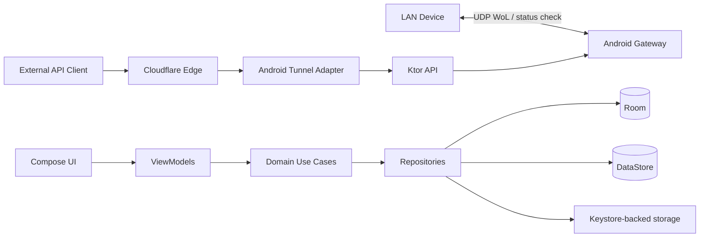

# Architecture — WoL Gateway

**Status:** CP6 REST API, CP7 Cloudflare runtime, and CP9 Standard Mode background service implemented and user-approved; CP7 and CP9 device validation passed; root layer remains planned
**Prinsip:** dependency direction jelas, mode standar tidak bergantung root/tunnel, resource lifecycle eksplisit.

## 1. Bentuk deployment



## 2. Layering

### Presentation

Compose screens, reusable components, Hilt ViewModels, immutable UI state, UI events, lifecycle-aware Flow collection. `AppNavHost` owns the single app-level `Scaffold` plus route chrome (app bar, FAB, snackbar host); no bottom navigation bar is used. The app-shell `DevicesViewModel` is passed to device/form routes so save events reach the single snackbar host. `DevicesViewModel` also exposes the shared `TunnelController.state` so `GatewayStatusStrip` displays live tunnel status without a duplicate state machine. App-bar titles are the only page headings. Screen composables render content only and must not create nested `Scaffold` instances. UI styling uses warm surfaces, deep navy ink, restrained cyan actions, and semantic status accents. Tidak memuat socket, DAO, atau business rule.

User-facing text is centralized in `app/src/main/res/values/strings.xml`. Composables resolve text with `stringResource`; ViewModel events carry string resource IDs and arguments rather than localized text. Screen content that can exceed the viewport uses a scroll container (`LazyColumn` or `verticalScroll`); app-bar titles remain outside screen content.

### Domain

Model `Device`, status/result enums, validation, use cases, repository/service interfaces, retry/state transition rules. Pure Kotlin sebisa mungkin agar unit test murah.

### Data

Room entity/DAO/database, DataStore preferences, secure secret adapter, repository implementations, mapping persistence/domain. Hilt menyediakan database, preferences, dan repository bindings pada `SingletonComponent`.

### Gateway

Ktor server lifecycle, routing, DTO, serializers, auth middleware, request validation, error mapping, repository/use-case calls. Tidak memanggil UI atau Android service langsung. CP6 menyediakan `/api/v1` health, device CRUD, status, dan wake routes. Settings mengatur port serta start/stop melalui `GatewayServer`; bind selalu `127.0.0.1`; token management tetap berada di secure-store boundary.

### WoL/network

Magic packet builder, UDP sender, discovery adapter, status checker, network interface provider. Discovery memilih Wi-Fi/Ethernet sebelum cellular, membatasi concurrency, menerapkan timeout per host dan total scan, mendeduplikasi result, serta menjaga hostname sebagai metadata internal. Add Devices mempertahankan state discovery di ViewModel back-stack; navigation ke form tidak memicu scan baru. Semua I/O asynchronous dan cancellable.

### Tunnel

`TunnelController`, state machine, `TunnelRuntime` adapter, health monitor, retry policy, process/native runtime adapter. `TunnelViewModel` reads the non-secret API port preference and supplies the loopback origin `127.0.0.1:<port>`; tunnel origin is not independently editable. Auto-reconnect is a non-secret DataStore preference, while the Cloudflare token remains in its separate Keystore-backed store. Kandidat `cloudflared-android` diisolasi di layer ini.

### Android service

Foreground service, notification, boot/network callbacks, lifecycle coordinator, start/stop command handling. Service memanggil controller; tidak memiliki business rule duplikat.

CP9 menambahkan `GatewayService`, dengan `GatewayCoordinator` sebagai pemilik lifecycle API dan tunnel yang dijalankan saat boot. `BootReceiver` membaca preference non-secret dan memulai service secara best-effort setelah `BOOT_COMPLETED`; network availability meminta tunnel recovery. Tunnel autostart selalu membutuhkan token tersimpan dan API service aktif. Battery optimization status/guidance tersedia di Settings dan dialog awal ditampilkan pada Devices saat optimization masih aktif. Status visibilitas notification terpisah dari lifecycle service: penolakan `POST_NOTIFICATIONS` atau channel yang diblokir tidak boleh menghentikan API maupun tunnel. Android/OEM battery policy dan background-start restrictions tetap dapat membatasi hasil.
Manual API or tunnel start also enters the foreground-service lifecycle. API stop disconnects tunnel and clears both autostart preferences; tunnel stop leaves the local API running.
Sebagian OEM/ROM Android 13 dapat membunuh process saat permission berubah melalui policy vendor. Ini dicatat sebagai keterbatasan device-specific; Standard Mode tervalidasi normal pada Android 10 dan Android 13 device kedua. Lifecycle aplikasi tidak mengklaim dapat mencegah vendor process kill.

### Root

`RootCapabilityDetector`, `RootDiagnosticsAdapter`, optional supervisor/discovery adapter. Interface berada di domain/tunnel boundary; implementasi root tidak bocor ke UI atau repository.

## 3. Package layout

Tetap satu module sampai kebutuhan build/runtime terbukti. Package awal:

```text
com.yihs.wolgateway
├── app
│   └── WolGatewayApplication.kt
├── di
│   └── AppModule.kt
├── data
│   ├── local
│   │   └── entity
│   ├── preferences
│   ├── secure
│   └── repository
├── domain
│   ├── model
│   ├── repository
│   ├── service
│   └── usecase
├── gateway
│   ├── auth
│   ├── dto
│   ├── routing
│   └── server
├── network
│   ├── discovery
│   ├── status
│   └── wol
├── tunnel
│   ├── adapter
│   ├── model
│   ├── retry
│   └── state
├── androidservice
├── root
└── ui
    ├── navigation
    │   └── AppNavHost.kt
    ├── screen
    │   ├── devices
    │   │   ├── DevicesScreen.kt
    │   │   └── DevicesViewModel.kt
    │   ├── device
    │   │   ├── detail/DeviceDetailsScreen.kt
    │   │   └── form/DeviceFormScreen.kt
    │   ├── add_devices
    │   │   └── AddDevicesScreen.kt
    │   ├── settings/SettingsScreen.kt
    │   └── api_settings/ApiSettingsScreen.kt
    ├── component
    │   ├── DeviceListItem.kt
    │   ├── DeviceSearchBar.kt
    │   ├── DeviceStatusIndicator.kt
    │   ├── EmptyState.kt
    │   └── GatewayStatusStrip.kt
    └── theme
```

The current `ui/screen` tree contains only feature pages: `devices`, `add_devices`, `device/detail`, `device/form`, and `settings`. Obsolete `dashboard`, `detail`, and `adddevices` directories are removed; empty screen directories are not retained.

Jangan membuat module/abstraction tambahan sebelum ada kebutuhan nyata.

Aturan struktur: setiap top-level class, interface, enum, data class, dan Compose component berada pada file sendiri. Entity Room berada di `data/local/entity`; implementasi server berada di `gateway/server`. `MainActivity` hanya menjadi host lifecycle dan memanggil `AppNavHost`; layout screen/component tidak diletakkan di Activity.

CP1 memilih Hilt sebagai dependency injection framework. `MainActivity` memakai `@AndroidEntryPoint`; ViewModel memakai `@HiltViewModel` dan Compose mengambilnya melalui `hiltViewModel()`. Manual service locator tidak digunakan.

## 4. Data ownership

| Data | Storage | Catatan |
|---|---|---|
| Device records | Room | IP/MAC/broadcast/WoL port/status-check metadata; MAC unique, IP may repeat after Room migration `2 -> 3` |
| UI/service preferences | DataStore | Non-secret only |
| API token | Keystore-backed secure store | Tidak masuk DataStore/log |
| Tunnel token | Keystore-backed secure store | Tidak ditampilkan penuh |
| Runtime state | Flow/controller memory | Persist hanya metadata aman |
| Diagnostics | bounded in-memory/log output + derived UI state | redaction wajib; copy output harus stabil dan safe |

Tunnel auto-reconnect preference is stored in DataStore as non-secret UI/runtime configuration. Disconnect clears the preference. It cannot enable a connection without a saved tunnel token; the UI keeps connect disabled and reports the missing token.

Tunnel controller failures retain redacted diagnostics in Logcat but expose only allowlisted user-safe causes. A failed connect is never represented as `CONNECTED`; the UI derives the switch from the runtime state and therefore returns it off.
The initial controller state exposes `tokenConfigured = false` without a start-failure error. The ViewModel renders the token form and places the token-required or connection-failure message in the Connection section.

Diagnostics is exposed through one Settings → Diagnostics page. A diagnostics provider aggregates general runtime facts and mode-specific facts without owning service/controller lifecycle. General data covers app/device/network/API/tunnel/service state and safe errors. Standard Mode data covers foreground-service/notification state, API/tunnel autostart preferences, service mode, and relevant OS/OEM limitations. Root Mode data is isolated behind root capability/consent checks and covers privilege verification, supervisor state, root-dependent availability, fallback, and safe errors. Root capability can be shown as informational data while Standard Mode is active.

Diagnostics output is bounded, derived, and redacted at the provider boundary. Copy serialization uses an allowlist, stable labels, and `configured/not configured` markers for secrets. It never includes raw shell output, commands, credentials, sensitive paths, or privilege-escalation details. Missing rooted hardware blocks Root Mode validation; it does not make Standard Mode diagnostics fail.

## 5. Lifecycle

Satu `GatewayCoordinator` mengatur server, tunnel, dan service state. Start harus idempotent; stop harus cancellable dan menunggu cleanup bounded. Process exit/tunnel health tidak boleh disimpulkan dari boolean historis saja.

Ktor memakai graceful shutdown dan `ApplicationStopped` cleanup. Android embedded server menonaktifkan `watchPaths` karena auto-reload tidak diperlukan di APK dan dapat meninggalkan `WatchService` finalizer noise saat stop/start. Foreground service hanya menjadi host lifecycle; ViewModel tidak memiliki service singleton global.

## 6. API security boundary

Auth middleware berjalan sebelum route sensitif. Token dibuat otomatis saat inisialisasi pertama atau disimpan dari custom input, lalu di-copy secara masked melalui halaman API; automatic mode dapat membuat token baru. State API dikelola terpisah oleh `ApiSettingsViewModel`; custom mode yang belum disimpan hanya draft dan dibuang saat navigasi keluar. Perbandingan token constant-time. Error response tidak mengungkap secret. AES-GCM encryption memakai IV yang dibuat Cipher/Keystore; IV disimpan bersama ciphertext untuk dekripsi. Health endpoint hanya mengembalikan status minimal. Bind API selalu `127.0.0.1`; hanya port `1024..65535` yang dapat diubah. Kegagalan bind dipetakan menjadi error recoverable, bukan uncaught coroutine exception.

## 7. Tunnel architecture decision

### Candidate

`roufsweb/cloudflared-android` sebagai referensi implementasi Android native. Bukan dependency production.

### Constraint

- Target aplikasi ditetapkan ARM64 (`arm64-v8a`); ABI lain bukan scope.
- Reference app memakai `targetSdk = 28`, sedangkan proyek ini `targetSdk = 37`.
- Reference token storage berupa `SharedPreferences`, tidak memenuhi requirement secret storage.
- Runtime, license, native loading, DNS workaround, process health, dan Android 15/16 behavior harus diuji.

### Decision

CP7 tetap menjadi `TECHNICAL SPIKE`. Source/binary `roufsweb/cloudflared-android` tidak digunakan. Official Cloudflare/cloudflared `2026.10.0` pada commit `18cdfe0a6fc7b72a0702d255a1f984e776ce0498` dibuild sendiri untuk Android ARM64 dengan Go `1.26.0`, `GOOS=android`, `GOARCH=arm64`, dan `CGO_ENABLED=0`; SHA-256 artifact `C1D7F45057016C6771655316A5AA114FF4419D06FA194580544004E4EE199E6D`. Binary dibundel sebagai `jniLibs/arm64-v8a/libcloudflared.so` dan dijalankan langsung dari `ApplicationInfo.nativeLibraryDir`; app cache/code cache tidak digunakan karena dapat dimount `noexec`. Token memakai encrypted Android Keystore storage, temporary app-private token file, dan `--token-file`; tidak ditempatkan di command argument. Config ingress app-private meneruskan traffic ke local Ktor origin. Adapter interface tetap memungkinkan runtime lain tanpa mengubah domain/API. Android ARM64 end-to-end validation passed on the target non-root device.

## 8. Status semantics

Target status:

- `ONLINE`: ICMP atau TCP status check berhasil.
- `OFFLINE`: hanya bila metode yang tersedia memberi bukti kuat target tidak reachable.
- `UNKNOWN`: hasil ambigu; ICMP/TCP gagal tidak cukup membuktikan PC mati.

Default Windows target check: ICMP aktif + TCP port `3389` aktif. Port dapat diubah per device. WoL UDP port `9` tetap terpisah dari TCP status check. RDP disabled/firewall blocked menghasilkan `UNKNOWN`, bukan otomatis `OFFLINE`.

Gateway/tunnel/API status tidak boleh dipetakan langsung ke target status.

## 9. Main risks

| Risiko | Dampak | Mitigasi | Gate |
|---|---|---|---|
| cloudflared runtime | tinggi | CP7 spike + adapter/fallback | CP7 |
| Android background/OEM | tinggi | FGS, diagnostics, real-device matrix | CP9 |
| MAC discovery unavailable | sedang | manual input + UNKNOWN | CP4 |
| WoL network topology | tinggi | broadcast config + target test | CP5 |
| secret leakage | tinggi | Keystore, redaction, review | CP6/8 |
| root assumptions | sedang | optional adapter/fallback | CP10 |
| SDK/dependency compatibility | sedang | pin versions, build gates | CP1 |

## 10. Validation fixtures

- Standard fixture: non-rooted Android 10 ARM64.
- Root fixture: rooted Android 13 ARM64; hanya dipakai pada CP10.
- Local tunnel fixture: Android ARM64, Ktor, self-built runtime dari official Cloudflare source, local forwarding, health, auth.
- External fixture: testing subdomain, active tunnel, health/auth request from a different network.
