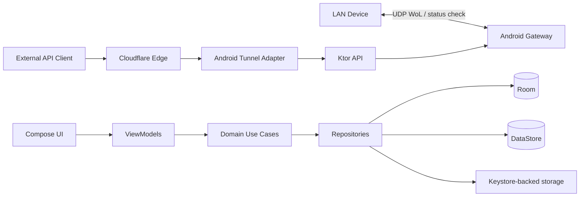

# Architecture — WoL Gateway

**Status:** Proposed — Checkpoint 1 foundation implemented
**Prinsip:** dependency direction jelas, mode standar tidak bergantung root/tunnel, resource lifecycle eksplisit.

## 1. Bentuk deployment



## 2. Layering

### Presentation

Compose screens, reusable components, Hilt ViewModels, immutable UI state, UI events, lifecycle-aware Flow collection. Tidak memuat socket, DAO, atau business rule.

### Domain

Model `Device`, status/result enums, validation, use cases, repository/service interfaces, retry/state transition rules. Pure Kotlin sebisa mungkin agar unit test murah.

### Data

Room entity/DAO/database, DataStore preferences, secure secret adapter, repository implementations, mapping persistence/domain. Hilt menyediakan database, preferences, dan repository bindings pada `SingletonComponent`.

### Gateway

Ktor server lifecycle, routing, DTO, serializers, auth middleware, request validation, error mapping, repository/use-case calls. Tidak memanggil UI atau Android service langsung. CP1 hanya menyediakan lifecycle skeleton; route dan product behavior masuk CP6.

### WoL/network

Magic packet builder, UDP sender, discovery adapter, status checker, network interface provider. Semua I/O asynchronous dan cancellable.

### Tunnel

`TunnelController`, state machine, `TunnelRuntime` adapter, health monitor, retry policy, process/native runtime adapter. Kandidat `cloudflared-android` diisolasi di layer ini.

### Android service

Foreground service, notification, boot/network callbacks, lifecycle coordinator, start/stop command handling. Service memanggil controller; tidak memiliki business rule duplikat.

### Root

`RootCapabilityDetector`, `RootDiagnosticsAdapter`, optional supervisor/discovery adapter. Interface berada di domain/tunnel boundary; implementasi root tidak bocor ke UI atau repository.

## 3. Proposed package layout

Tetap satu module sampai kebutuhan build/runtime terbukti. Package awal:

```text
com.yihs.wolgateway
├── app
│   └── WolGatewayApplication.kt
├── data
│   ├── local
│   │   └── entity
│   ├── preferences
│   ├── secure
│   └── repository
├── domain
│   ├── model
│   ├── repository
│   ├── service
│   └── usecase
├── gateway
│   ├── auth
│   ├── dto
│   ├── routing
│   └── server
├── network
│   ├── discovery
│   ├── status
│   └── wol
├── tunnel
│   ├── adapter
│   ├── model
│   ├── retry
│   └── state
├── androidservice
├── root
└── ui
    ├── navigation
    │   └── AppNavHost.kt
    ├── screen
    │   └── dashboard
    │       ├── DashboardScreen.kt
    │       └── FoundationViewModel.kt
    ├── component
    └── theme
```

Jangan membuat module/abstraction tambahan sebelum ada kebutuhan nyata.

Aturan struktur: setiap top-level class, interface, enum, data class, dan Compose component berada pada file sendiri. Entity Room berada di `data/local/entity`; implementasi server berada di `gateway/server`. `MainActivity` hanya menjadi host lifecycle dan memanggil `AppNavHost`; layout screen/component tidak diletakkan di Activity.

CP1 memilih Hilt sebagai dependency injection framework. `MainActivity` memakai `@AndroidEntryPoint`; ViewModel memakai `@HiltViewModel` dan Compose mengambilnya melalui `hiltViewModel()`. Manual service locator tidak digunakan.

## 4. Data ownership

| Data | Storage | Catatan |
|---|---|---|
| Device records | Room | IP/MAC/broadcast/WoL port/status-check metadata |
| UI/service preferences | DataStore | Non-secret only |
| API token | Keystore-backed secure store | Tidak masuk DataStore/log |
| Tunnel token | Keystore-backed secure store | Tidak ditampilkan penuh |
| Runtime state | Flow/controller memory | Persist hanya metadata aman |
| Diagnostics | bounded in-memory/log output | redaction wajib |

## 5. Lifecycle

Satu `GatewayCoordinator` mengatur server, tunnel, dan service state. Start harus idempotent; stop harus cancellable dan menunggu cleanup bounded. Process exit/tunnel health tidak boleh disimpulkan dari boolean historis saja.

Ktor memakai graceful shutdown dan `ApplicationStopped` cleanup. Foreground service hanya menjadi host lifecycle; ViewModel tidak memiliki service singleton global.

## 6. API security boundary

Auth middleware berjalan sebelum route sensitif. Token rotation atomic terhadap secure store. Error response tidak mengungkap apakah token/device internal tertentu ada bila tidak perlu. Health endpoint hanya mengembalikan status minimal.

## 7. Tunnel architecture decision

### Candidate

`roufsweb/cloudflared-android` sebagai referensi implementasi Android native. Bukan dependency production.

### Constraint

- Target aplikasi ditetapkan ARM64 (`arm64-v8a`); ABI lain bukan scope.
- Reference app memakai `targetSdk = 28`, sedangkan proyek ini `targetSdk = 37`.
- Reference token storage berupa `SharedPreferences`, tidak memenuhi requirement secret storage.
- Runtime, license, native loading, DNS workaround, process health, dan Android 15/16 behavior harus diuji.

### Decision

`TECHNICAL SPIKE` pada CP7. Tidak memasukkan source/binary referensi ke aplikasi. Jika diperlukan, build binary sendiri dari source Cloudflare/cloudflared yang dipin untuk ARM64 Android, dengan toolchain, patch, checksum, provenance, dan license terdokumentasi. Adapter interface memungkinkan fallback external tunnel atau runtime lain tanpa mengubah domain/API. Public hostname diuji setelah gateway lokal stabil.

## 8. Status semantics

Target status:

- `ONLINE`: ICMP atau TCP status check berhasil.
- `OFFLINE`: hanya bila metode yang tersedia memberi bukti kuat target tidak reachable.
- `UNKNOWN`: hasil ambigu; ICMP/TCP gagal tidak cukup membuktikan PC mati.

Default Windows target check: ICMP aktif + TCP port `3389` aktif. Port dapat diubah per device. WoL UDP port `9` tetap terpisah dari TCP status check. RDP disabled/firewall blocked menghasilkan `UNKNOWN`, bukan otomatis `OFFLINE`.

Gateway/tunnel/API status tidak boleh dipetakan langsung ke target status.

## 9. Main risks

| Risiko | Dampak | Mitigasi | Gate |
|---|---|---|---|
| cloudflared runtime | tinggi | CP7 spike + adapter/fallback | CP7 |
| Android background/OEM | tinggi | FGS, diagnostics, real-device matrix | CP9 |
| MAC discovery unavailable | sedang | manual input + UNKNOWN | CP4 |
| WoL network topology | tinggi | broadcast config + target test | CP5 |
| secret leakage | tinggi | Keystore, redaction, review | CP6/8 |
| root assumptions | sedang | optional adapter/fallback | CP10 |
| SDK/dependency compatibility | sedang | pin versions, build gates | CP1 |

## 10. Validation fixtures

- Standard fixture: non-rooted Android 10 ARM64.
- Root fixture: rooted Android 13 ARM64; hanya dipakai pada CP10.
- Local tunnel fixture: Android ARM64, Ktor, self-built runtime dari official Cloudflare source, local forwarding, health, auth.
- External fixture: testing subdomain, active tunnel, health/auth request from a different network.
