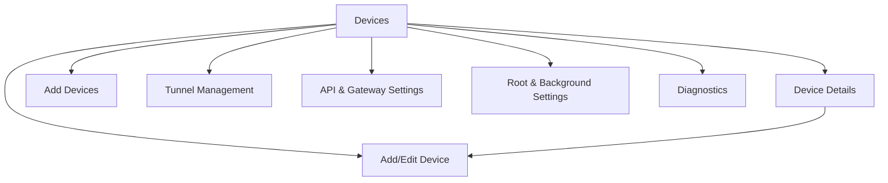

# UI/UX Design — WoL Gateway

**Status:** Implemented icon-theme redesign; functionality-preserving UI checkpoint
**Tanggal:** 2026-11-04

## 1. Design direction

### Tone

Premium network console: precise, calm, high-contrast, technical. The icon supplies the identity: dark navy depth, electric cyan actions, bright blue secondary emphasis, ice-white content, and selective orange attention.

### Principles

- Status operasional lebih penting daripada dekorasi.
- Satu hierarchy: gateway health → device list → action.
- Warna hanya aksen; setiap status memiliki label dan ikon.
- Gunakan surface hierarchy, bukan kumpulan kartu seragam.
- Hindari gradient ungu, layout centered-only, dan rounded card berlebihan.
- Material 3 digunakan sebagai komponen dasar; token aplikasi mengatur karakter visual.
- Compose screen tidak memuat business logic.
- Surfaces carry hierarchy through tonal steps; shadows are reserved for floating or modal UI.
- Technical identifiers use monospace selectively; ordinary product copy stays in the platform sans-serif.

### Icon-derived palette

| Role | HEX | Usage |
|---|---|---|
| Dark Navy | `#06152F` | Dark background, dark ink |
| Deep Blue | `#0B2445` | Dark surface |
| Elevated Blue | `#10345B` | Dark raised surface |
| Electric Cyan | `#00C8F5` | Dark primary action |
| Bright Blue | `#078BF0` | Light primary action |
| Ice White | `#F4F8FF` | Dark foreground |
| Orange | `#FF941F` | Selective attention |
| Light Background | `#F3F8FF` | Light screen background |
| Light Raised | `#FFFFFF` | Light surface |
| Light Elevated | `#E8F3FF` | Light raised surface |

### Semantic status colors

`statusPositive` / `tealStatus` = `#35B89A`; `statusCaution` / `amberStatus` = `#FFB547`; `statusNegative` / `rustStatus` = `#E2685B`; `statusNeutral` / `slateStatus` = `#8EA5BF`. Status always combines color with text and an icon.

## 2. Navigation map



### Primary navigation

- No bottom `NavigationBar` is used. The Devices app-bar action opens Settings; the Devices FAB and empty-state add action open Add Devices.
- Add Devices starts a local-network scan on entry, shows reachable results directly, and always provides manual registration.
- `Settings` groups Tunnel, API/Gateway, Background/Root, and Diagnostics. Background controls include separate API-service and tunnel autostart switches; tunnel autostart is unavailable until a tunnel token is configured and reports safe connection errors inline. Turning on Tunnel also turns on the API service; turning off API disconnects Tunnel. Foreground notification copy distinguishes API-only from API+tunnel.
- Devices remains the start destination.

## 3. Screen inventory

### Devices

Top app bar: title “Devices”, settings action. Below: gateway summary strip showing API, the live tunnel state, and service as separate labeled indicators. The tunnel indicator mirrors `TunnelController.state` and updates for not configured, disconnected, connecting, connected, reconnecting, and error. Main content is a `LazyColumn` of device rows/cards. FAB and empty-state add action open Add Devices; Add Devices owns network scan and manual registration.

Device item hierarchy: name + status label, IP on its own line, MAC on its own line, last check time, and primary Wake action only when status is not `ONLINE`. Tapping the row opens Device Details. There is no overflow menu in the device item. Do not show status-check method or port in the item. Swipe actions are optional; never replace accessible explicit actions.

Device item uses a compact stacked row rather than a wide horizontal metadata layout:

```text
┌────────────────────────────────┐
│ ● Office PC             ONLINE │
│   192.168.1.20                 │
│   AA:BB:CC:DD:EE:FF            │
│   Checked 2 min ago            │
│                    [WAKE] [⋮] │
└────────────────────────────────┘
```

IP and MAC may wrap on narrow screens or with font scaling; neither is forcibly truncated. Port and check method remain available on Device Details.

### Add Devices

Top app bar title is “Add Devices”; content has no duplicate page heading. On first entry, scan the active Wi-Fi/Ethernet IPv4 subnet automatically and show reachable hosts in a list with IP, explicit MAC-unavailable guidance, and open common TCP ports. Hide discovery results whose IP already exists in saved devices. Hostname is best-effort internal metadata and is not shown before registration. Preserve completed results when navigating to Add device and returning; do not scan again unless the user pulls to refresh or retries a failed scan. Show scanning, empty, failure, retry, and pull-to-refresh states. Tapping a result opens the add form with IP prefilled; manual registration remains available as a persistent bottom action.

### Device Discovery

Network context: active interface/subnet and permission note. Add Devices scans automatically on first entry. Results show the IP, explicit MAC-unavailable guidance, and reachable common TCP ports; saved IPs are excluded, hostname remains best-effort internal metadata and is not shown before registration. Completed results support pull-to-refresh; tapping a result opens registration with its IP prefilled. Manual registration remains visible as a primary fallback and may reuse an IP when the MAC differs.

### Device Details

Header: device name, status label, address metadata. Action group: Wake, Check status, Edit. Sections: last check/method, last WoL result, network parameters, safe troubleshooting explanation. Show “packet sent” separately from “target online”.

Device Details uses a vertically scrollable content column. Network parameters are grouped into Wake-on-LAN and Availability check sections with aligned labels and values; explanatory status text stays in a separate tonal surface.

### Add/Edit Device

Scrollable form with name, IPv4 address, MAC, broadcast address, WoL port, optional status-check method/port. Name, IP, MAC, broadcast, and numeric port fields constrain input while typing; final validation remains authoritative. App-bar title is “Add device” for a new record and “Edit device” for an existing record. Inline validation, examples, keyboard-safe layout, and success/failure snackbar feedback are required. MAC manual entry is first-class, not an error fallback hidden behind discovery. Save from a new device returns directly to Devices; returning to Add Devices does not rescan.

### Tunnel Management

One `Connection` surface contains the connection status and connect switch. A separate auto-reconnect section appears only while the connection is on. A separate tunnel-token section shows the token form immediately when unconfigured, otherwise a masked preview with edit. The connect switch is disabled until a tunnel token is saved and shows an inline setup message while unconfigured. Auto-reconnect is enabled only while the connection switch is on and is cleared on disconnect. There is no manual reconnect action. The tunnel origin is not editable: runtime ingress always follows the API Settings loopback origin `127.0.0.1:<port>`. Token save/replacement follows the API token editing pattern, but tunnel secrets remain separately encrypted and the token preview has no copy action. Token editing is unavailable while connecting, connected, or reconnecting. Runtime errors are redacted to user-safe messages. Last connection time, health monitoring, remove configuration, and retry/backoff policy remain CP8 scope. Reconnecting must not claim connected before runtime verification.

### API & Gateway Settings

Settings opens a dedicated API page containing an API server switch, a fixed loopback URL card with copy and port-edit actions, and automatic/custom token modes. The URL is always `http://127.0.0.1:<port>`; only ports `1024..65535` are editable. Tokens remain masked; copy, custom edit, and automatic refresh are available. Show a copy-confirmation snackbar for URL and token copy actions. Show API server status separately from tunnel status. API server toggle success is reflected by the switch/status only; show a snackbar for port-save results and bind/configuration errors, not routine start/stop.

The API page also links to a dedicated CORS origins page. CORS is always active. Development and production each use a multiline text field containing complete `http://` or `https://` origins separated by commas. Notes explain the required scheme, comma separator, and that paths do not belong in an origin. Save is labeled “Save & restart service”; it persists first, then restarts API and an active tunnel in that order.

### Root & Background Settings

Standard Mode selected by default. Root capability and permission status are informational until user opts in. Service controls, notification state, battery optimization guidance, boot recovery limitation, and OEM troubleshooting. When battery optimization remains enabled, show a startup dialog on Devices with a link to system settings; refresh status on resume.

### Diagnostics

Settings opens one scrollable `Diagnostics` page. The page always contains a `General` section with Android version/ABI, device classification (automatic test, emulator, or real device), active network interface, API server, tunnel, `GatewayService`, app version, and last safe errors. Secret values show only “configured/not configured” or an explicitly redacted form.

The page is mode-aware, not split into separate Standard/Root pages:

- `Standard Mode`: service running state, API-only/API+tunnel mode, foreground-service and notification status, API/tunnel autostart preferences, and relevant battery/OEM or boot-recovery limitations. Root capability remains informational.
- `Root Mode`: root capability, user consent, privilege-check result, supervisor status, root-dependent feature availability, fallback status, and root-specific safe errors.

The Settings Diagnostics row navigates to this page. Include an explicit copy action with stable, copy-safe redaction. Do not show raw shell output, commands, credentials, tokens, sensitive paths, or privilege-escalation details. Use `DiagnosticItem` states `pass`, `warn`, `fail`, and `not configured`.

Diagnostics uses three separate Material surfaces/cards: `General`, `Thermal`, and the effective service mode (`Standard Mode` or `Root Mode`). General contains runtime/device/battery/API facts; Thermal contains overall thermal status, battery temperature, optional thermal headroom, source/mode, normalized sensor readings, and sample availability; Service Mode contains only the active mode diagnostics. Values use Celsius and technical monospace styling. Missing thermal data shows `unknown`; status uses text and icon, never color alone. Root-only sensor names and paths remain redacted.

## 4. Design tokens

### Color semantic tokens

Light and dark themes must define these semantic roles rather than hardcoding status colors:

| Token | Meaning |
|---|---|
| `statusPositive` | online/connected/success |
| `statusCaution` | connecting/reconnecting/attention |
| `statusNegative` | confirmed offline/error/failure |
| `statusNeutral` | unknown/not configured/disconnected |
| `contentPrimary` | main text |
| `contentSecondary` | metadata/help |
| `surfaceBase` | screen background |
| `surfaceRaised` | elevated operational block |
| `accentAction` | Wake/save/connect primary action |

Dark mapping uses `#06152F` background, `#0B2445` surfaces, `#10345B` raised surfaces, `#00C8F5` primary, `#078BF0` secondary, `#FF941F` tertiary, and `#F4F8FF` foreground. Light mapping uses `#F3F8FF` background, `#FFFFFF` surfaces, `#E8F3FF` raised surfaces, `#078BF0` primary, `#536A84` secondary, `#FF941F` tertiary, and `#06152F` ink.

### Typography

Material 3 uses the Android platform sans-serif; no font dependency was added. Screen titles use bold hierarchy. Body text remains readable at 16sp/24sp. `bodySmall` supports metadata at 13sp/18sp. `labelLarge` is bold for actions and status labels. `FontFamily.Monospace` is limited to IP addresses, MAC addresses, URLs, ports, tokens, and diagnostic values.

### Spacing

Base 4 dp scale: 4, 8, 12, 16, 24, 32. Dense metadata may use 8–12 dp; screen sections use 24–32 dp.

### Shape

- List rows: small radius or divider-led structure.
- Operational panels: medium radius.
- Destructive confirmation: standard dialog shape.
- Avoid applying one radius to every component.

### Elevation

Use surface tonal elevation first. Shadows only for floating actions/dialogs; no identical shadow on every card.

### Component standards

- Filled buttons use the theme primary color; secondary actions use outlined or tonal buttons.
- Inputs use Material 3 outlined fields with inline validation and supporting copy.
- Operational surfaces use the medium application shape; list rows use small/medium shapes consistently.
- Status indicators expose accessible text and icon; color alone is insufficient.
- Icon buttons retain Material minimum touch targets and content descriptions.
- Search, empty, loading, error, and diagnostic states reuse existing shared components.

## 5. Reusable components

| Component | Purpose | Required states |
|---|---|---|
| `DeviceStatusIndicator` | status icon + text + optional method | online/offline/unknown/loading |
| `DeviceListItem` | compact device row | normal/waking/error/disabled |
| `GatewayStatusStrip` | separate API/tunnel/service status | healthy/partial/stopped/error |
| `WakeDeviceButton` | explicit WoL action | idle/loading/sent/failed |
| `DeviceSearchBar` | query filter | empty/active/cleared |
| `NetworkScanResultItem` | discovery result | IP, MAC unavailable, open ports, tappable |
| `DeviceForm` | add/edit fields | pristine/invalid/saving/error |
| `TunnelTokenField` | masked secret input | hidden/revealed/saved/error |
| `DiagnosticItem` | safe component diagnostic | pass/warn/fail/not configured |
| `ConfirmationDialog` | destructive action confirmation | open/cancel/confirm |
| `LoadingState` | progress feedback | initial/action/refresh |
| `EmptyState` | no device/result/config | contextual CTA |
| `ErrorState` | recoverable failure | retry/details |

All interactive icons need content descriptions and at least 48 dp touch target.

## 6. State and interaction rules

### Device

- `ONLINE`: positive label + icon + last check time.
- `OFFLINE`: negative label only when evidence supports it.
- `UNKNOWN`: neutral label and explanation of method limitation.
- Wake action shows progress, then `PACKET_SENT` or failure. Never changes target status to online automatically.
- Combined checks show the method(s), timestamp, and reason. A single failed ICMP check does not render the target offline.
- Windows target default shows ICMP + TCP `3389`; explain that disabled/blocked RDP produces `UNKNOWN`. Port overrides remain visible in device details.
- Devices auto-checks visible devices every 60 seconds. Auto-check pauses when Devices is not visible.
- A newly saved device runs one best-effort status check immediately after persistence; save success is not reverted when probing fails.
- Manual `Check status` is always available from Device Details; pull-to-refresh checks all saved devices.
- After Wake, one-shot checks run at 5, 15, and 30 seconds, then stop.
- Background service does not poll target devices.

### Tunnel

- `NOT_CONFIGURED`: token form + setup message; no masked placeholder or edit icon.
- `DISCONNECTED`: connect CTA.
- `CONNECTING`: progress, disable duplicate connect.
- `CONNECTED`: disconnect/reconnect actions; show last verified health.
- `RECONNECTING`: retry/backoff detail.
- `ERROR`: safe error summary + retry/configuration CTA.
- Connect is unavailable until a tunnel token is configured; show an inline token-required message.
- Auto-reconnect is persisted as a non-secret preference, available only while connected, and cleared on disconnect.
- Token edit controls are hidden/disabled while connecting, connected, or reconnecting.
- A failed connection returns the connection switch to off and exposes only a short safe cause below the status.
- Tunnel ingress uses the API Settings port and is not independently editable.
- Connection, auto-reconnect, and tunnel-token sections use dividers; auto-reconnect is hidden while connection is off.

### Gateway

API server, tunnel, target device, and background service each get separate labels. A connected tunnel must not produce an overall “system healthy” state if API or target checks fail.

### Feedback

- Snackbar for non-destructive success/failure.
- Dialog for delete and port changes.
- Inline errors for form fields.
- Snackbar for every save result: success, validation failure, duplicate MAC, or persistence failure.
- Persistent notification only for active service; never include token or sensitive endpoint data. Notification permission/channel visibility must not control service, API, or tunnel lifecycle.
- OEM process-kill behavior after permission changes is device-specific. Standard Mode validation passes on Android 10 and Android 13 device two; no vendor-specific workaround is required.

## 7. Responsive/accessibility rules

- All screens scroll, especially forms and diagnostics.
- Device Details and Settings use `verticalScroll`; device and Add Devices lists use `LazyColumn`; the form remains keyboard-safe and vertically scrollable.
- `WindowSizeClass` determines rail/drawer/compact layout.
- Keyboard uses `adjustResize` and focus/scroll behavior.
- User-facing copy belongs in Android `strings.xml`; no hardcoded UI labels, actions, content descriptions, or snackbar messages in screen code.
- Support font scaling without clipped status labels.
- Contrast must meet accessible text contrast target.
- Status uses icon + text + optional shape, never color only.
- Touch targets minimum 48 dp.
- TalkBack order follows operational hierarchy.
- Error and loading states expose semantic descriptions.

## 8. Compose conventions

- Screen-level composables receive immutable state and event lambdas.
- ViewModels expose `StateFlow<UiState>` and event methods; production ViewModels use Hilt constructor injection and `hiltViewModel()` retrieval.
- Use lifecycle-aware collection.
- `MainActivity` hanya menjadi host lifecycle; navigation, screen, dan reusable component berada pada file/package masing-masing.
- Screen files follow page ownership: `ui/screen/devices`, `ui/screen/add_devices`, `ui/screen/device/detail`, `ui/screen/device/form`, and `ui/screen/settings`. Obsolete dashboard/detail/add-device folders are not part of the project structure.
- Gunakan single-scaffold pattern: `AppNavHost` menjadi pemilik tunggal `Scaffold`, top app bar, FAB, dan snackbar host. Tidak ada bottom `NavigationBar`; screen composables hanya menerima state/event lalu merender content; jangan membuat nested `Scaffold`.
- Setiap Compose screen/component memiliki file sendiri; preview ditempatkan bersama component yang dipreview.
- Keep previews with representative online/offline/unknown/loading/error states.
- Reuse tokens/components; no screen-local duplicated status colors.
- No network/database calls in Composable bodies.
- UI test tags only where semantic selectors are insufficient.

## 9. Guidelines for Adding New UI Features

1. Read `docs/DESIGN.md` before implementing any new UI feature.
2. Reuse centralized colors, typography, spacing, shape, and status tokens.
3. Reuse existing shared components whenever the interaction or state already exists.
4. Preserve the single-Scaffold ownership model and existing navigation architecture.
5. Maintain both dark and light themes; never hardcode theme-specific colors in a screen.
6. Maintain 48dp minimum touch targets, content descriptions, readable contrast, font scaling, and scroll-safe layouts.
7. Never introduce arbitrary colors, gradients, decorative glows, or inconsistent component radii.
8. Keep user-facing text in `strings.xml`; keep network, database, and business logic outside composables.
9. Update this document when adding a reusable pattern or changing the design system.

## 9. Text wireframe

```text
┌ Devices ─────────────── Search  ⋮ ┐
│ API     Running     Tunnel  Off  │
│ Service Standard     [details]   │
├──────────────────────────────────┤
│ DEVICES                          │
│ Office PC                 ONLINE │
│ 192.168.1.20 · AA:BB:…           │
│ Checked 2 min ago     [WAKE] [⋮] │
│                                  │
│ Media PC                 UNKNOWN │
│ 192.168.1.30 · MAC unavailable   │
│ No reliable check      [WAKE] [⋮]│
│                                  │
│                         [ + Add ]│
└──────────────────────────────────┘
```

## 10. Resolved design decisions

- ARM64-only tunnel target.
- API bind is permanently loopback-only at `127.0.0.1`; only the port is configurable.
- API token UI defaults to an automatically generated encrypted token, with masked preview/copy, custom token editing, and automatic refresh; revoke and reveal are omitted. Unsaved custom selection is discarded on navigation.
- Root Mode is hidden under advanced settings and deferred until Standard Mode is stable.
- Tunnel domain/public hostname setup is deferred until local gateway stability.
- Device list uses compact stacked rows; IP and MAC appear on separate unlabelled lines.
- Device items show last-check time only; method and port remain in Device Details.
- Devices auto-check interval is 60 seconds with manual check and post-Wake checks at 5/15/30 seconds.

## 11. Finalized implementation notes

- Palette: static elegant industrial-console palette: warm off-white surfaces, deep navy ink, restrained cyan action, desaturated teal positive, rust negative, slate unknown; no dynamic color dependency for brand/status consistency.
- Typography: Material default with explicit hierarchy, readable metadata, and no new font dependency.
- Styling direction: elegant and clean operational UI; tonal surfaces over repeated cards, restrained accents, compact stacked device rows, and minimal chrome.
- Status-check configuration: per-device advanced settings, with ICMP + TCP 3389 defaults.
- Accessibility: verify contrast for navy/cyan in light and dark themes during CP3.
