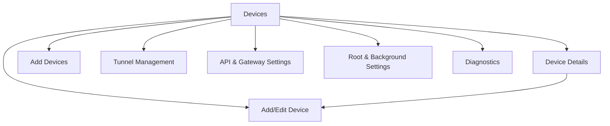

# UI/UX Design — WoL Gateway

**Status:** Approved specification — CP3 UI and CP7 tunnel page/runtime implemented and validated; CP4/CP5 behavior remains deferred
**Tanggal:** 2026-10-26

## 1. Design direction

### Tone

Industrial network console: tenang, padat informasi, utilitarian, bukan dekorasi dashboard. Fokus visual pada “apa yang dapat dijalankan sekarang” dan “bukti status apa yang tersedia”.

### Principles

- Status operasional lebih penting daripada dekorasi.
- Satu hierarchy: gateway health → device list → action.
- Warna hanya aksen; setiap status memiliki label dan ikon.
- Gunakan surface hierarchy, bukan kumpulan kartu seragam.
- Hindari gradient ungu, layout centered-only, dan rounded card berlebihan.
- Material 3 digunakan sebagai komponen dasar; token aplikasi mengatur karakter visual.
- Compose screen tidak memuat business logic.

## 2. Navigation map



### Primary navigation

- No bottom `NavigationBar` is used. The Devices app-bar action opens Settings; the Devices FAB and empty-state add action open Add Devices.
- Add Devices starts a local-network scan on entry, shows reachable results directly, and always provides manual registration.
- `Settings` groups Tunnel, API/Gateway, Background/Root, and Diagnostics.
- Devices remains the start destination.

## 3. Screen inventory

### Devices

Top app bar: title “Devices”, settings action. Below: gateway summary strip showing API, tunnel, and service as separate labeled indicators. Main content is a `LazyColumn` of device rows/cards. FAB and empty-state add action open Add Devices; Add Devices owns network scan and manual registration.

Device item hierarchy: name + status label, IP on its own line, MAC on its own line, last check time, and primary Wake action only when status is not `ONLINE`. Tapping the row opens Device Details. There is no overflow menu in the device item. Do not show status-check method or port in the item. Swipe actions are optional; never replace accessible explicit actions.

Device item uses a compact stacked row rather than a wide horizontal metadata layout:

```text
┌────────────────────────────────┐
│ ● Office PC             ONLINE │
│   192.168.1.20                 │
│   AA:BB:CC:DD:EE:FF            │
│   Checked 2 min ago            │
│                    [WAKE] [⋮] │
└────────────────────────────────┘
```

IP and MAC may wrap on narrow screens or with font scaling; neither is forcibly truncated. Port and check method remain available on Device Details.

### Add Devices

Top app bar title is “Add Devices”; content has no duplicate page heading. On first entry, scan the active Wi-Fi/Ethernet IPv4 subnet automatically and show reachable hosts in a list with IP, explicit MAC-unavailable guidance, and open common TCP ports. Hide discovery results whose IP already exists in saved devices. Hostname is best-effort internal metadata and is not shown before registration. Preserve completed results when navigating to Add device and returning; do not scan again unless the user pulls to refresh or retries a failed scan. Show scanning, empty, failure, retry, and pull-to-refresh states. Tapping a result opens the add form with IP prefilled; manual registration remains available as a persistent bottom action.

### Device Discovery

Network context: active interface/subnet and permission note. Add Devices scans automatically on first entry. Results show the IP, explicit MAC-unavailable guidance, and reachable common TCP ports; saved IPs are excluded, hostname remains best-effort internal metadata and is not shown before registration. Completed results support pull-to-refresh; tapping a result opens registration with its IP prefilled. Manual registration remains visible as a primary fallback and may reuse an IP when the MAC differs.

### Device Details

Header: device name, status label, address metadata. Action group: Wake, Check status, Edit. Sections: last check/method, last WoL result, network parameters, safe troubleshooting explanation. Show “packet sent” separately from “target online”.

Device Details uses a vertically scrollable content column. Network parameters are grouped into Wake-on-LAN and Availability check sections with aligned labels and values; explanatory status text stays in a separate tonal surface.

### Add/Edit Device

Scrollable form with name, IPv4 address, MAC, broadcast address, WoL port, optional status-check method/port. Name, IP, MAC, broadcast, and numeric port fields constrain input while typing; final validation remains authoritative. App-bar title is “Add device” for a new record and “Edit device” for an existing record. Inline validation, examples, keyboard-safe layout, and success/failure snackbar feedback are required. MAC manual entry is first-class, not an error fallback hidden behind discovery. Save from a new device returns directly to Devices; returning to Add Devices does not rescan.

### Tunnel Management

State header with text + explanatory sentence. Token field remains masked, supports encrypted save and replacement, and never copies the full secret. Connect/reconnect/disconnect are available; runtime errors are redacted. Last connection time, health monitoring, remove configuration, and retry/backoff policy remain CP8 scope. Reconnecting must not claim connected before runtime verification.

### API & Gateway Settings

Settings opens a dedicated API page containing an API server switch, a combined base URL card with copy/edit actions, and automatic/custom token modes. Tokens remain masked; copy, custom edit, and automatic refresh are available. Loopback is the visible default; explain LAN exposure before enabling non-loopback bind. Show API server status separately from tunnel status.

### Root & Background Settings

Standard Mode selected by default. Root capability and permission status are informational until user opts in. Service controls, notification state, battery optimization guidance, boot recovery limitation, and OEM troubleshooting.

### Diagnostics

Dense diagnostic list: Android version/ABI, network interface, API server, tunnel, service, root, last safe errors, app version. Secret values show only “configured/not configured” or redacted form. Include copy-safe diagnostics with explicit redaction.

## 4. Design tokens

### Color semantic tokens

Light and dark themes must define these semantic roles rather than hardcoding status colors:

| Token | Meaning |
|---|---|
| `statusPositive` | online/connected/success |
| `statusCaution` | connecting/reconnecting/attention |
| `statusNegative` | confirmed offline/error/failure |
| `statusNeutral` | unknown/not configured/disconnected |
| `contentPrimary` | main text |
| `contentSecondary` | metadata/help |
| `surfaceBase` | screen background |
| `surfaceRaised` | elevated operational block |
| `accentAction` | Wake/save/connect primary action |

Suggested palette: warm graphite/navy surfaces, off-white primary text, restrained amber action accent, desaturated teal positive, rust negative, slate unknown. Exact Material 3 light/dark values are finalized during CP3 after contrast verification.

### Typography

Use the project’s Material 3 typography with a distinct display treatment for screen titles only if bundled/licensed font availability is confirmed. No new font dependency by default. Body text prioritizes readability and font scaling.

### Spacing

Base 4 dp scale: 4, 8, 12, 16, 24, 32. Dense metadata may use 8–12 dp; screen sections use 24–32 dp.

### Shape

- List rows: small radius or divider-led structure.
- Operational panels: medium radius.
- Destructive confirmation: standard dialog shape.
- Avoid applying one radius to every component.

### Elevation

Use surface tonal elevation first. Shadows only for floating actions/dialogs; no identical shadow on every card.

## 5. Reusable components

| Component | Purpose | Required states |
|---|---|---|
| `DeviceStatusIndicator` | status icon + text + optional method | online/offline/unknown/loading |
| `DeviceListItem` | compact device row | normal/waking/error/disabled |
| `GatewayStatusStrip` | separate API/tunnel/service status | healthy/partial/stopped/error |
| `WakeDeviceButton` | explicit WoL action | idle/loading/sent/failed |
| `DeviceSearchBar` | query filter | empty/active/cleared |
| `NetworkScanResultItem` | discovery result | IP, MAC unavailable, open ports, tappable |
| `DeviceForm` | add/edit fields | pristine/invalid/saving/error |
| `TunnelTokenField` | masked secret input | hidden/revealed/saved/error |
| `DiagnosticItem` | safe component diagnostic | pass/warn/fail/not configured |
| `ConfirmationDialog` | destructive action confirmation | open/cancel/confirm |
| `LoadingState` | progress feedback | initial/action/refresh |
| `EmptyState` | no device/result/config | contextual CTA |
| `ErrorState` | recoverable failure | retry/details |

All interactive icons need content descriptions and at least 48 dp touch target.

## 6. State and interaction rules

### Device

- `ONLINE`: positive label + icon + last check time.
- `OFFLINE`: negative label only when evidence supports it.
- `UNKNOWN`: neutral label and explanation of method limitation.
- Wake action shows progress, then `PACKET_SENT` or failure. Never changes target status to online automatically.
- Combined checks show the method(s), timestamp, and reason. A single failed ICMP check does not render the target offline.
- Windows target default shows ICMP + TCP `3389`; explain that disabled/blocked RDP produces `UNKNOWN`. Port overrides remain visible in device details.
- Devices auto-checks visible devices every 60 seconds. Auto-check pauses when Devices is not visible.
- Manual `Check status` is always available from Device Details; pull-to-refresh checks all saved devices.
- After Wake, one-shot checks run at 5, 15, and 30 seconds, then stop.
- Background service does not poll target devices.

### Tunnel

- `NOT_CONFIGURED`: setup CTA.
- `DISCONNECTED`: connect CTA.
- `CONNECTING`: progress, disable duplicate connect.
- `CONNECTED`: disconnect/reconnect actions; show last verified health.
- `RECONNECTING`: retry/backoff detail.
- `ERROR`: safe error summary + retry/configuration CTA.

### Gateway

API server, tunnel, target device, and background service each get separate labels. A connected tunnel must not produce an overall “system healthy” state if API or target checks fail.

### Feedback

- Snackbar for non-destructive success/failure.
- Dialog for delete and potentially disruptive bind changes.
- Inline errors for form fields.
- Snackbar for every save result: success, validation failure, duplicate MAC, or persistence failure.
- Persistent notification only for active service; never include token or sensitive endpoint data.

## 7. Responsive/accessibility rules

- All screens scroll, especially forms and diagnostics.
- Device Details and Settings use `verticalScroll`; device and Add Devices lists use `LazyColumn`; the form remains keyboard-safe and vertically scrollable.
- `WindowSizeClass` determines rail/drawer/compact layout.
- Keyboard uses `adjustResize` and focus/scroll behavior.
- User-facing copy belongs in Android `strings.xml`; no hardcoded UI labels, actions, content descriptions, or snackbar messages in screen code.
- Support font scaling without clipped status labels.
- Contrast must meet accessible text contrast target.
- Status uses icon + text + optional shape, never color only.
- Touch targets minimum 48 dp.
- TalkBack order follows operational hierarchy.
- Error and loading states expose semantic descriptions.

## 8. Compose conventions

- Screen-level composables receive immutable state and event lambdas.
- ViewModels expose `StateFlow<UiState>` and event methods; production ViewModels use Hilt constructor injection and `hiltViewModel()` retrieval.
- Use lifecycle-aware collection.
- `MainActivity` hanya menjadi host lifecycle; navigation, screen, dan reusable component berada pada file/package masing-masing.
- Screen files follow page ownership: `ui/screen/devices`, `ui/screen/add_devices`, `ui/screen/device/detail`, `ui/screen/device/form`, and `ui/screen/settings`. Obsolete dashboard/detail/add-device folders are not part of the project structure.
- Gunakan single-scaffold pattern: `AppNavHost` menjadi pemilik tunggal `Scaffold`, top app bar, FAB, dan snackbar host. Tidak ada bottom `NavigationBar`; screen composables hanya menerima state/event lalu merender content; jangan membuat nested `Scaffold`.
- Setiap Compose screen/component memiliki file sendiri; preview ditempatkan bersama component yang dipreview.
- Keep previews with representative online/offline/unknown/loading/error states.
- Reuse tokens/components; no screen-local duplicated status colors.
- No network/database calls in Composable bodies.
- UI test tags only where semantic selectors are insufficient.

## 9. Text wireframe

```text
┌ Devices ─────────────── Search  ⋮ ┐
│ API     Running     Tunnel  Off  │
│ Service Standard     [details]   │
├──────────────────────────────────┤
│ DEVICES                          │
│ Office PC                 ONLINE │
│ 192.168.1.20 · AA:BB:…           │
│ Checked 2 min ago     [WAKE] [⋮] │
│                                  │
│ Media PC                 UNKNOWN │
│ 192.168.1.30 · MAC unavailable   │
│ No reliable check      [WAKE] [⋮]│
│                                  │
│                         [ + Add ]│
└──────────────────────────────────┘
```

## 10. Resolved design decisions

- ARM64-only tunnel target.
- Loopback-only API default; LAN exposure is opt-in and authenticated.
- API token UI defaults to an automatically generated encrypted token, with masked preview/copy, custom token editing, and automatic refresh; revoke and reveal are omitted. Unsaved custom selection is discarded on navigation.
- Root Mode is hidden under advanced settings and deferred until Standard Mode is stable.
- Tunnel domain/public hostname setup is deferred until local gateway stability.
- Device list uses compact stacked rows; IP and MAC appear on separate unlabelled lines.
- Device items show last-check time only; method and port remain in Device Details.
- Devices auto-check interval is 60 seconds with manual check and post-Wake checks at 5/15/30 seconds.

## 11. Finalized implementation notes

- Palette: static elegant industrial-console palette: warm off-white surfaces, deep navy ink, restrained cyan action, desaturated teal positive, rust negative, slate unknown; no dynamic color dependency for brand/status consistency.
- Typography: Material default with explicit hierarchy, readable metadata, and no new font dependency.
- Styling direction: elegant and clean operational UI; tonal surfaces over repeated cards, restrained accents, compact stacked device rows, and minimal chrome.
- Status-check configuration: per-device advanced settings, with ICMP + TCP 3389 defaults.
- Accessibility: verify contrast for navy/cyan in light and dark themes during CP3.
